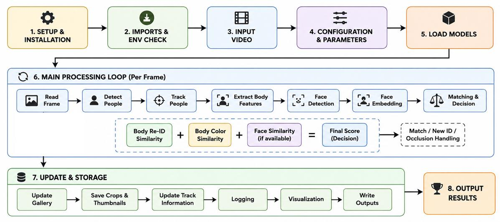
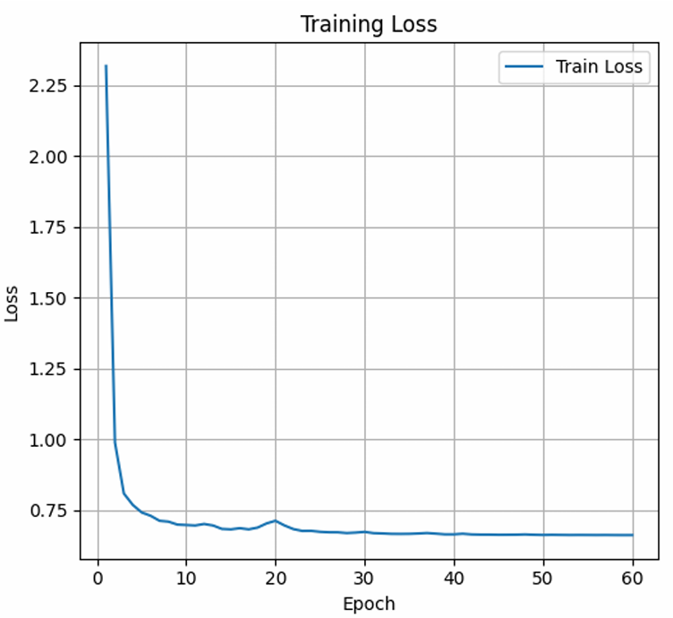
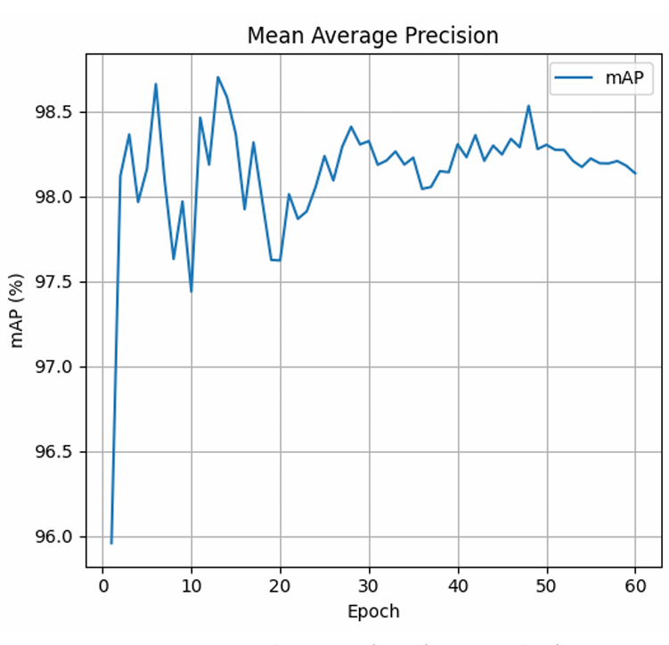

# Human Re-Identification for Crowd Management

Final Year Project, BSc Electrical Engineering, Namal University, Mianwali (2026).

This project detects, tracks and re-identifies people in recorded video so that a person who leaves the camera view and comes back is not counted twice. It uses YOLOv8 for person detection, BoT-SORT for short-term tracking and an OSNet appearance model fine-tuned on a self-collected dataset. An identity gallery decides whether a returning person is new or already known.

**Authors:** Muhammad Wajid Jamal and Muhammad Usman Shah. Both authors worked on every stage of the project: data collection, model fine-tuning, pipeline implementation, testing and report writing.
**Supervisor:** Dr. Mudassar Raza

## At a glance

| | |
|---|---|
| Task | Unique person counting in recorded video using detection, tracking and re-identification |
| Models | YOLOv8, BoT-SORT, OSNet-AIN x1.0 (fine-tuned) |
| Dataset | 14,200 person crops of more than 30 people, collected by the authors (not public) |
| Test split | 11,335 train, 2,830 test/gallery, 35 query images |
| Reported accuracy | mAP of about 98% and Rank-1 of 97.14% on the authors' own 35-query test set |
| Scope | Recorded video, one camera setup, several viewing angles |

The accuracy values come from a small self-collected test set. They are not benchmark results. See [Experimental results](#experimental-results) for what the evidence is and what it is not.

## Project overview

Counting systems that only count detections count the same person again every time they re-enter the view. A tracker keeps an identity while a person stays visible, but when the person leaves or is blocked for a long time, the tracker usually assigns a new ID. This makes the count too high.

In this project the three stages have different jobs:

- **Detection** finds people in each frame.
- **Tracking** links the detections of one person across consecutive frames and gives a temporary track ID.
- **Re-identification** turns a person crop into an appearance vector and compares it with vectors of people seen earlier, so a returning person can get their earlier identity back and the unique count only increases for a new person.

The intended use is unique-person counting in controlled indoor crowd monitoring, for example halls and event rooms.

## Research objectives

From section 1.4 of the report:

1. Detect people in recorded crowd videos.
2. Follow detected people from frame to frame while they are in view.
3. Fine-tune an OSNet-based re-identification model on cropped person images and use it to extract appearance features.
4. Compare extracted features with stored identities to match returning people.
5. Increase the unique count only when a new person appears, to reduce repeated counting.
6. Test the Google Coral TPU for edge-based feature extraction.
7. Assess the system in recorded videos with different lighting, viewing angles, occlusion and clothing.
8. Design the matching approach so it can later be extended to several cameras.

## System architecture

*Pipeline as drawn in the report (Figure 3.8). The notebook in this repository follows the same stages. It does not include the body-colour similarity term shown in the figure, and its face branch uses MTCNN and FaceNet.*

How the information moves through the notebook:

1. **YOLOv8** detects people in each frame. The Ultralytics tracker runs **BoT-SORT** on the detections and returns a temporary track ID for each person.
2. A **crop-quality check** scores every tracked crop (size, sharpness, brightness, occlusion, frame edge). The best crop of each track is kept.
3. Once a track has a good crop, **OSNet** converts it into a 512-dimensional vector. This is done once per track.
4. The vector is compared with the **identity gallery** by cosine similarity. If the best score passes the threshold and is clearly ahead of the second-best identity, the track gets that identity. Otherwise a new identity is created.
5. The output is an annotated video with a unique-person counter and CSV logs of every decision.

More detail is in [docs/methodology.md](docs/methodology.md).

## Methodology

- **Dataset preparation:** crops were taken from the authors' own recordings, cleaned and grouped by person.
- **Detection and tracking:** YOLOv8 with BoT-SORT, restricted to the person class.
- **Feature extraction and fine-tuning:** OSNet-AIN x1.0, pretrained on ImageNet and fine-tuned for 60 epochs on 11,335 crops using softmax and triplet loss with AdamW.
- **Matching:** cosine similarity between L2-normalised vectors, with a score threshold and a margin over the second-best identity.
- **Optional face cue:** a face embedding from MTCNN and FaceNet can be mixed into the score when a face is visible. It is switched off in the submitted notebook.
- **Evaluation:** query-gallery retrieval (mAP per epoch, Top-10 retrieval example) and 16 test cases on recorded videos.

## Dataset

| Split | Images | Purpose |
|---|---|---|
| Training | 11,335 | OSNet fine-tuning |
| Testing / gallery | 2,830 | Query-gallery evaluation |
| Query | 35 | Query-gallery evaluation |
| Total | 14,200 | |

- The data were recorded by the authors in the project environment. People walked through the view, left it and came back, in front, side and back views, in normal and low light, with similar clothing and with occlusion.
- Crops were extracted with the detection stage, and poor-quality crops were removed. Images are grouped by identity.
- This is a **self-collected dataset**. It is not a public benchmark such as Market-1501, and its results cannot be compared with benchmark numbers.
- Participants gave written consent for academic use (Appendix A of the report). The dataset, the extracted crops and the recordings are not published here. Example frames appear only inside the report.
- Limits: about 30 people, one recording setup and a small query set. The report does not state whether the query and gallery people were excluded from the training images.

## Technologies used

| Tool | Role | Version |
|---|---|---|
| Python, Google Colab | Training and running the notebook | Not recorded |
| PyTorch | Deep learning framework | Not recorded |
| Ultralytics YOLOv8 | Person detection and the BoT-SORT tracker interface | Not recorded |
| BoT-SORT | Multi-object tracking | Through Ultralytics |
| Torchreid (deep-person-reid) | OSNet-AIN x1.0 model and feature extractor | Installed from GitHub |
| OpenCV | Video reading and writing, crop-quality checks, drawing | Not recorded |
| facenet-pytorch | MTCNN face detector and FaceNet embeddings (optional branch) | Not recorded |
| pandas, NumPy, tqdm, Pillow | Logging, arrays, progress bars, images | Not recorded |
| Google Coral USB Accelerator, TensorFlow Lite | Separate edge feature-extraction test | Code not included |

Versions were not recorded when the project was run. See [requirements.txt](requirements.txt).

## Experimental results

All values are from the authors' own dataset. Details and caveats are in [docs/results.md](docs/results.md).

| Result | Value | Source |
|---|---|---|
| Fine-tuning | 60 epochs, 11,335 training images | Report, Table 3.1 |
| mAP on the query-gallery set | About 98% at epoch 60 (roughly 97.4% to 98.7% after the first epoch, read from the plot) | Report, Figure 5.22 |
| Rank-1 accuracy | 97.14% on 35 queries | Project presentation, slide 11 |
| Top-10 retrieval example | 9 to 10 of the top 10 images were the same person (one query, about 1,000 gallery images) | Report, Table 5.10 |
| Video test cases | 16 test cases; unique count stable when a returning person was re-identified, lower accuracy in low light, with occlusion and with similar clothing | Report, Tables 5.11 and 5.15 |

**What Rank-1 means here:** the share of the 35 query images whose most similar gallery image shows the same person. 97.14% equals 34 of 35 queries. The value is given in the presentation, not in the report text, and the script that produced it is not in this repository.

**How to read these numbers:**

- The query set has only 35 images. One query changes the result by about 2.9 percentage points.
- The test images come from the same recordings as the training images, and it is not documented that the test people were held out of training. The numbers describe performance on the project dataset, not on new people or new places.
- Unique counting in the videos was judged by inspecting outputs and logs. No counting error rate against ground truth is reported.

## Visual results

*Report Figure 5.21: training loss over 60 epochs.*

*Report Figure 5.22: mAP on the query-gallery set during training.*

Example frames of detection, tracking and re-identification are in the report (Figures 4.12 to 4.18 and 5.23 to 5.25). They show participants and are not copied into this repository.

## Installation and setup

The notebook was written for Google Colab and installs its packages in its first cell.

- **Python:** not recorded. Use the Colab default runtime.
- **Hardware:** a GPU runtime is recommended. The notebook metadata lists a T4 GPU.
- **Dependencies:** see [requirements.txt](requirements.txt). Note that `facenet-pytorch` 2.6.0 limits `torch` to 2.2.x, `numpy` below 2 and `Pillow` below 10.3.
- **Model weights:**
  - The fine-tuned OSNet checkpoint (`best_model.pth`) is **not included**. You need your own OSNet-AIN x1.0 checkpoint trained on person identities.
  - `yolov8m.pt` is the default YOLOv8 weight file. Ultralytics normally downloads it on first use.
  - The FaceNet and MTCNN weights are downloaded by `facenet-pytorch`.
- **Not tested:** this installation procedure has not been re-run as part of this cleanup.

## Running the project

1. Open [notebooks/Source_Code.ipynb](notebooks/Source_Code.ipynb) in Google Colab with a GPU runtime.
2. Upload an input video and your OSNet checkpoint to Google Drive.
3. In the `Config` class at the top of the first code cell, set `INPUT_VIDEO` and `OSNET_CHECKPOINT`. They currently point to the authors' Drive paths. The notebook stops with a `FileNotFoundError` if either file is missing.
4. Run the first cell. It installs the packages, tracks the video, identifies people and writes the results to `/content/reid_botsort_output/current_video_<video name>/`. The notebook deletes this folder at the start of each run for the same video (`RESET_OUTPUT_EACH_RUN`).
5. The later cells only download the results from Colab to your computer.

Main outputs: `final_annotated_video.mp4`, `identity_decisions.csv`, `ranking_scores.csv`, `tracker_to_final_identity.csv`, `identity_gallery.csv`, `summary_counts_and_ids.csv`, `person_crops.zip` and `gallery_features.npy`.

The saved notebook output shows a run on a 1920 x 1080, 29.99 fps video with 8,293 frames at about 10 frames per second for the first pass on a Colab GPU. The notebook processes recorded video in two passes and is not a live system.

### Reproducibility status

| Item | In this repository |
|---|---|
| Inference notebook | Yes (syntax checked, not re-run) |
| Fine-tuned OSNet weights | No |
| OSNet training and evaluation code (mAP, Rank-1) | No |
| Dataset and test videos | No |
| Coral TPU code and TFLite model | No |
| Report and presentation | Yes |

The repository documents the project and its inference code. It does not allow the reported accuracy to be reproduced from the files it contains.

## Project limitations

- Tested on recorded video from one camera setup with several angles, not on several cameras or a live feed.
- Small, self-collected dataset (about 30 people) and a 35-image query set.
- Performance depends on crop quality. Blur, darkness and partial visibility weaken the match.
- Similar clothing can produce close scores for different people.
- Heavy occlusion can cause track loss and a new identity for a returning person.
- Accuracy is lower in low light and in back or side views.
- Faces are often not visible, so the face cue helps only in some front-view frames.
- Thresholds were tuned during testing and not on a separate calibration set.
- The Coral TPU test covers feature extraction only.

More detail, including limits of this repository, is in [docs/limitations.md](docs/limitations.md).

## Future work

- Test with several cameras and a shared identity gallery.
- Run on live video with faster inference and gallery management.
- Collect a larger and more varied dataset, and evaluate on public re-identification datasets with held-out identities.
- Improve low-light, occlusion and similar-clothing cases, for example with image enhancement, part-based features and more training data from hard conditions.
- Replace fixed thresholds with a calibrated or adaptive rule.
- Move more of the pipeline onto edge hardware.

## Authors and contributions

| Name | Contribution |
|---|---|
| Muhammad Wajid Jamal | Joint project work across all stages |
| Muhammad Usman Shah | Joint project work across all stages |

Both authors were involved in data collection, dataset preparation, model fine-tuning, pipeline implementation, testing and report writing. Supervisor: Dr. Mudassar Raza, Department of Electrical Engineering, Namal University, Mianwali.

## Report and references

- [Final year project report](reports/FYP_Report.pdf). Use of AI tools for writing support is disclosed in Appendix B of the report.
- [Project presentation](reports/Presentation.pptx)

References (from the report, plus Torchreid):

1. M. Ye, J. Shen, G. Lin, T. Xiang, L. Shao and S. C. H. Hoi, "Deep learning for person re-identification: A survey and outlook," *IEEE Transactions on Pattern Analysis and Machine Intelligence*, vol. 44, no. 6, pp. 2872-2893, 2022.
2. K. Zhou, Y. Yang, A. Cavallaro and T. Xiang, "Omni-scale feature learning for person re-identification," in *Proc. IEEE/CVF International Conference on Computer Vision*, 2019, pp. 3702-3712.
3. K. Zhou, Y. Yang, A. Cavallaro and T. Xiang, "Learning generalisable omni-scale representations for person re-identification," *IEEE Transactions on Pattern Analysis and Machine Intelligence*, vol. 44, no. 9, pp. 5056-5069, 2022.
4. N. Aharon, R. Orfaig and B.-Z. Bobrovsky, "BoT-SORT: Robust associations multi-pedestrian tracking," arXiv:2206.14651, 2022. <https://arxiv.org/abs/2206.14651>
5. K. Zhou and T. Xiang, "Torchreid: A library for deep learning person re-identification in Pytorch," arXiv:1910.10093, 2019. <https://arxiv.org/abs/1910.10093>
6. Ultralytics YOLOv8, software. <https://github.com/ultralytics/ultralytics>

## License

No license has been selected yet, so the code is not licensed for reuse. The project depends on third-party software with its own terms; for example, Ultralytics YOLOv8 is distributed under AGPL-3.0. The dataset is not published, and participants consented to academic use only.
