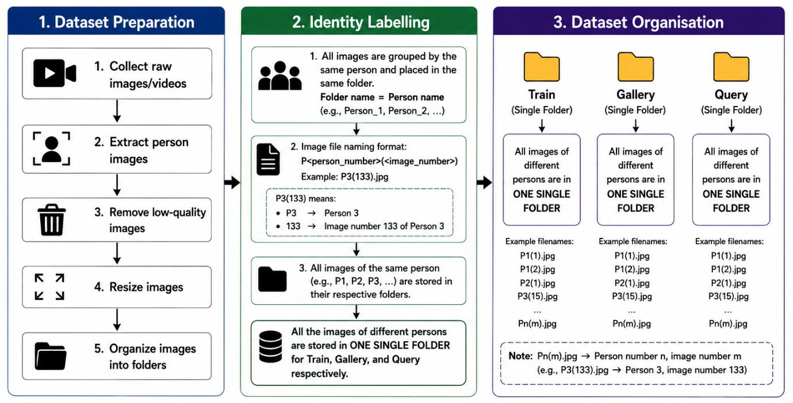
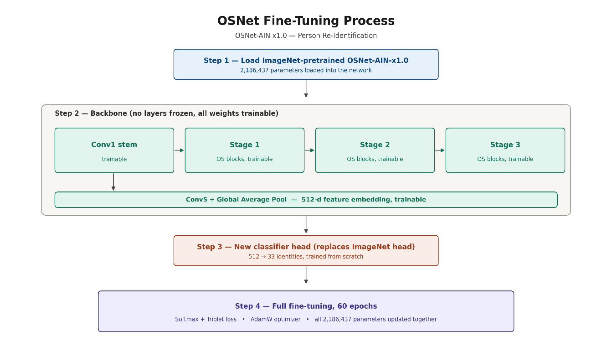
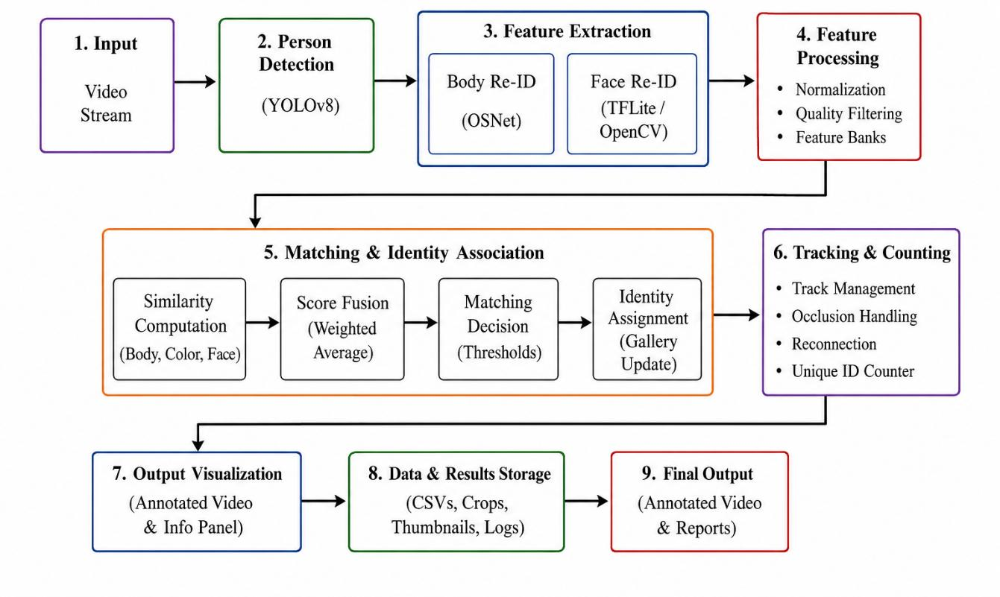

# Methodology

This page describes the methods used in the project. The main sources are the final report ([reports/FYP_Report.pdf](../reports/FYP_Report.pdf)) and the inference notebook ([notebooks/Source_Code.ipynb](../notebooks/Source_Code.ipynb)). Figure numbers follow the report body; the report's own list of figures uses different numbers.

## 1. Pipeline overview

| Stage | Method | Purpose |
|---|---|---|
| Person detection | YOLOv8 (person class only) | Find people in each frame |
| Short-term tracking | BoT-SORT (through the Ultralytics tracker) | Give each person a temporary track ID while visible |
| Crop selection | Image-quality checks (notebook) | Choose a good crop for each track |
| Feature extraction | OSNet-AIN x1.0, fine-tuned | Convert a crop into a 512-dimensional appearance vector |
| Matching | Cosine similarity with a threshold and margin | Decide if the person is already in the identity gallery |
| Optional face cue | MTCNN + FaceNet embedding | Extra similarity score when a face is found |
| Counting and logging | Identity gallery, CSV logs, annotated video | Unique count and a record of every decision |

A temporary track ID is not a final identity. When a person leaves the view or is blocked for a long time, the tracker can assign a new ID on return. The gallery matching stage exists to correct this.

## 2. Data collection and preparation

Source: report sections 3.1.2 and 3.1.3.

- Videos were recorded in the project environment. People walked through the view, left it, returned after a delay, walked in other directions and appeared in different lighting.
- Recordings include front, left, right and back views, similar clothing, occlusion, normal light and low light. All recordings used the same camera setup with different angles. No multi-camera evaluation was done.
- Person crops were taken from video frames using the detection stage. Poor-quality, very blurry and incomplete crops were removed where possible.
- Result: 14,200 usable cropped images of more than 30 people, grouped by identity and stored with names of the form `P<person>(<image>).jpg`.
- The images were split into train, gallery and query folders (see below).

*Report Figure 3.4: dataset preparation, identity labelling and organisation.*

| Split | Images | Purpose |
|---|---|---|
| Training | 11,335 | OSNet fine-tuning |
| Testing / gallery | 2,830 | Query-gallery evaluation |
| Query | 35 | Query-gallery evaluation |
| Total | 14,200 | |

The report states that participants gave consent (Appendix A of the report). The report does not say whether the people in the query and gallery images were excluded from the training images.

## 3. Preprocessing and augmentation

Source: report sections 3.1.4 and 3.1.5.

Crops are resized to 256 x 128 pixels, converted to tensors and normalised. Crops that are too small, blurred, dark or incomplete are not used. The report says realistic augmentations were applied during training to cover changes in lighting, viewing angle and image quality; it does not list the individual augmentations.

## 4. OSNet fine-tuning

Source: report section 3.1.6, Table 3.1 and Figure 3.5.

*Report Figure 3.5: OSNet fine-tuning process.*

| Item | Value |
|---|---|
| Base model | OSNet-AIN x1.0, pretrained on ImageNet |
| Trainable layers | All layers (none frozen) |
| Classifier head | New head, 512 features to 33 identities |
| Loss | Softmax (cross-entropy) with triplet loss |
| Optimiser | AdamW |
| Epochs | 60 |
| Input size | 256 x 128 pixels |
| Platform | Google Colab |

The training and evaluation code is not included in this repository. The notebook only loads the trained checkpoint (`best_model.pth`).

## 5. Detection, tracking and re-identification (as implemented in the notebook)

The notebook processes a recorded video in two passes.

**Pass 1: tracking, crop selection and identity decisions**

1. Each frame goes to YOLOv8 with the person class only and a confidence threshold of 0.35 (`yolo.track`, BoT-SORT).
2. The notebook writes a custom BoT-SORT configuration: `track_high_thresh` 0.55, `track_low_thresh` 0.10, `new_track_thresh` 0.70, `track_buffer` 90 frames, `match_thresh` 0.80, `gmc_method` sparseOptFlow and the tracker's own appearance matching switched on (`with_reid: True`).
3. For every tracked person in every frame, a crop-quality check runs. It looks at crop size (at least 35 x 90 px), aspect ratio, contact with the frame edge, sharpness (Laplacian variance), motion blur, brightness, contrast, noise, how much of the crop width contains edges, and overlap with other boxes (partial and severe occlusion). The result is a validity flag and a quality score between 0 and 1.
4. The best crop of each track is kept. A track is ready for identification once it has at least 8 valid crops and a best quality of at least 0.68, or after waiting 90 frames with a good valid crop, or with a fallback crop of quality at least 0.45. Any track not yet identified at the end of the video is processed then.
5. Each track is identified once. The best crop is passed through OSNet to get a 512-dimensional vector, which is L2-normalised.
6. The vector is compared with every stored vector of every identity in the gallery by cosine similarity. Each identity gets the highest score among its stored vectors.
7. Decision rule: if the best score is at least 0.73 and it is at least 0.05 above the second-best identity, the track is assigned the existing identity and its vector is added to that identity. Otherwise a new identity (`ID-001`, `ID-002`, ...) is created.

**Pass 2: output video**

The video is written again with the final identity labels, a live counter panel and a side panel showing each identity's crop, similarity and top-3 ranking. The counters are *On screen now*, *Total appears* (cumulative entries) and *Total unique IDs*.

Because identities are decided per track after a representative crop is chosen, and the output video is written in a second pass, the notebook as submitted is an offline pipeline for recorded video. It is not a live system.

**Outputs written by the notebook:** annotated video, `identity_decisions.csv`, `ranking_scores.csv`, `tracker_to_final_identity.csv`, `identity_gallery.csv`, `summary_counts_and_ids.csv`, a zip of selected crops, the gallery images and `gallery_features.npy`.

## 6. Optional face cue

When enabled, MTCNN looks for a face inside the selected body crop and a FaceNet network (`InceptionResnetV1`, VGGFace2 weights) produces a 512-dimensional face embedding. The score for an identity becomes

`final = (1 - w) * body_similarity + w * face_similarity`

and the face term is used only when both the query and the stored identity have a face embedding. In the notebook as submitted, `FACE_WEIGHT = 0`, so the face branch runs but does not change any decision.

## 7. Evaluation

Source: report chapters 4 and 5. Results are in [results.md](results.md).

- **Query-gallery evaluation of the OSNet model:** 35 query images against the test/gallery images, using cosine similarity. mAP was recorded for each training epoch.
- **Top-10 retrieval example:** one query image against about 1,000 gallery images, showing the 10 most similar images.
- **Test cases:** 16 test cases (report sections 4.5 to 4.20) covering detection, tracking, cropping, feature extraction, re-identification, Top-10 retrieval, unique counting, rank-based matching, face-assisted matching, similar clothing, occlusion, low light, multiple angles, multiple people, CSV logging and the Coral test. Most of these are run on recorded videos.
- **Coral Edge TPU test:** a separate check that a TensorFlow Lite feature-extraction model compiled for the Edge TPU can run on a Coral USB Accelerator. The detection and tracking stages stayed on the main software pipeline. The Coral code and model are not included here.

## 8. Settings: report and notebook

The values in the report and the defaults in the notebook are not the same. The report describes the settings used for its tests; the notebook shows the settings of the version that is in this repository.

| Setting | Report (Tables 3.2 and 4.5) | Notebook defaults |
|---|---|---|
| Detector | YOLOv8n, confidence 0.4 | `yolov8m.pt`, confidence 0.35 |
| Tracker | BoT-SORT, default parameters | BoT-SORT, custom configuration (section 5) |
| Body match threshold | 0.80 | 0.73, margin 0.05 |
| Body + face threshold | 0.82 | Face weight 0 (off) |
| Re-ID model | Fine-tuned OSNet | `osnet_ain_x1_0` with `best_model.pth` |

The CSV file shown in report Figure 4.19 is a frame-level log (`frame_idx`, `time_sec`, `track_token`, `assigned_id`, `rank1_id`, ...). The notebook writes per-track decision logs with different columns. This suggests that the report's tests were run with an earlier version of the pipeline that is not in this repository. The report's architecture figures also show a body-colour similarity term that the notebook does not contain.

*Report Figure 3.11: block diagram of the proposed system. This figure shows a TFLite/OpenCV face branch and a body-colour similarity term; the notebook uses MTCNN + FaceNet and has no colour term.*
