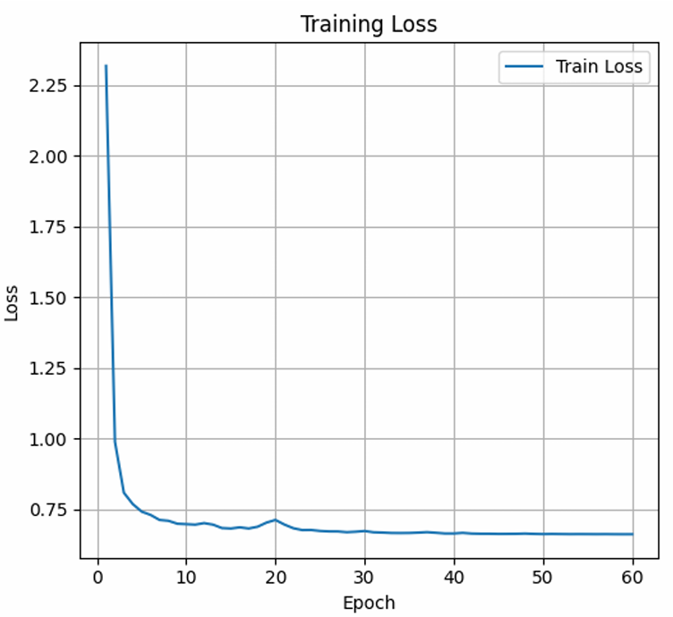
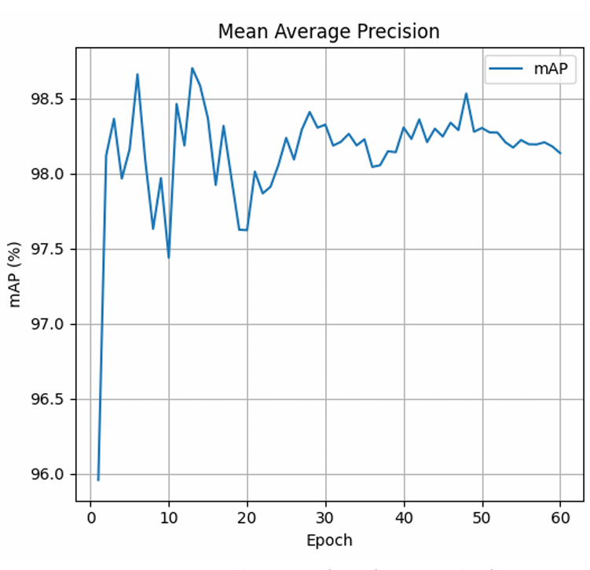

# Results

All results on this page come from the final report ([reports/FYP_Report.pdf](../reports/FYP_Report.pdf)) or, where stated, from the project presentation. They were measured on the project's own self-collected dataset. They are not results on a public benchmark and should not be compared with published Market-1501 or MSMT17 numbers.

## 1. Summary and evidence status

| Result | Value | Source | Evidence in this repository |
|---|---|---|---|
| Dataset | 14,200 usable person crops, more than 30 people | Report, Table 5.9 | Description only; images are not published |
| Data split | 11,335 train, 2,830 test/gallery, 35 query | Report, Table 5.9 | Description only |
| Training | 60 epochs; loss falls sharply in the first epochs, then levels off | Report, Figure 5.21 | Figure below |
| mAP on the query-gallery set | About 98% at epoch 60 (see below) | Report, Figure 5.22 | Figure below; no table of values in the report |
| Rank-1 accuracy | 97.14% on 35 queries | Presentation, slide 11 | Not in the report text; evaluation script not included |
| Top-10 retrieval example | 9 to 10 of the top 10 images were the same person (one representative query, about 1,000 gallery images) | Report, Table 5.10 | Single example, not an average |
| Video tests | 16 test cases, described as met or met in successful cases | Report, Table 5.15 | Qualitative; no counting error rate |
| Coral Edge TPU | Feature-extraction branch ran on the Coral USB Accelerator | Report, Table 5.14 | Code and model not included |

## 2. Training curves

*Report Figure 5.21: training loss of the OSNet-based model over 60 epochs.*

*Report Figure 5.22: mAP of the fine-tuned model on the query-gallery set, evaluated each epoch.*

Reading the plot, mAP starts near 96% at the first epoch, then stays roughly between 97.4% and 98.7%, and ends close to 98% at epoch 60. These values are read from the figure; the report does not give exact numbers. The report notes that small changes from epoch to epoch come from image angle, lighting, similar-looking people and query image quality.

## 3. Rank-1 accuracy

Rank-1 accuracy is the share of query images for which the most similar gallery image belongs to the same person.

The value 97.14% is shown on slide 11 of the project presentation. It equals 34 out of 35, which fits the 35-image query set. The report text mentions CMC accuracy but does not state a Rank-1 value or include a CMC plot, and the script that produced the figure is not part of this repository. For that reason the number is listed here as *reported in the presentation* and not as independently reproducible.

Points to keep in mind when reading it:

- The query set has 35 images. One more or fewer correct query changes the value by about 2.9 percentage points.
- The data come from the same self-collected recordings as the training images. The report does not state that the query and gallery people were excluded from training, and the classifier head in report Figure 3.5 has 33 identities, close to the "more than 30 people" in the whole dataset. The result should therefore be read as performance on the project dataset, not as performance on unseen people or other environments.
- The report's own discussion (section 6.6) says that the small query set means the results cannot be interpreted broadly.

## 4. Top-10 retrieval example

For one query image compared with about 1,000 gallery images, 9 to 10 of the 10 most similar gallery images showed the same person (report section 5.2.3 and Table 5.10). The retrieved images show a participant's face and are not reproduced in this repository.

## 5. Behaviour of the video pipeline

The report evaluates the video pipeline by inspecting outputs and CSV logs on recorded videos. It does not compute a counting error rate against ground-truth counts. The observations below are from report Tables 5.11 and 5.13.

| Condition | Observed behaviour |
|---|---|
| Normal light, distinct clothing, front view | Count stayed stable when a returning person was re-identified correctly |
| Low light | Weaker features; some repeated counting; accuracy lower than in normal light |
| Occlusion | Mild occlusion handled; heavy occlusion caused track loss and possible new IDs |
| Similar clothing | Close similarity scores between different people; some identities could be merged |
| Back view or side view | More uncertain matching and more new IDs; body features used when no face is visible |
| Several people in one frame | Each person tracked and given a separate identity |

Face-assisted matching was useful in selected front-view cases. In side-view, back-view, low-light and occluded frames the face was usually not available and the system used body features only.

Example frames for these tests are in the report (Figures 4.12 to 4.18 and 5.23 to 5.25). They are not copied into this repository because they show participants' faces.

## 6. Coral Edge TPU test

The Coral USB Accelerator was detected, and an Edge TPU compatible TensorFlow Lite feature-extraction model (`models/person_reid_edgetpu.tflite`) ran in the pipeline. Detection and tracking stayed on the main software pipeline. The report does not claim that the full YOLOv8 and OSNet pipeline runs on the Coral TPU. Setup problems with NumPy and OpenCV compatibility were found and solved during the test.
